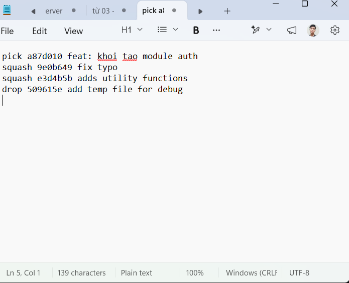
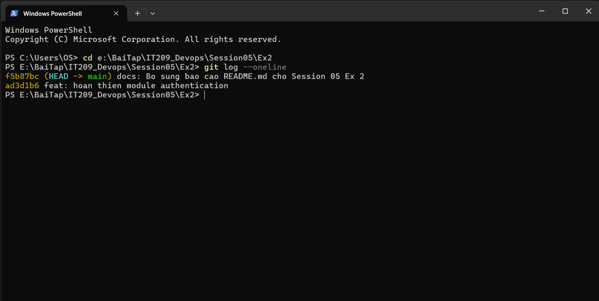

# Báo Cáo Bài Tập 2 (Session 05): Tái Cấu Trúc Lịch Sử Commit Bằng Interactive Rebase

- **Khóa học:** IT209 - DevOps
- **Họ và tên:** Nguyễn Tiến Thành
- **Mã số sinh viên (MSSV):** B24DTCN283
- **Email:** thenngk6@gmail.com
- **GitHub Username:** ThanhDZsudo
- **Đường dẫn nộp bài dự kiến:** `homework/session_05/ex2/`

---

## 1. Mục Tiêu Bài Tập
- Sử dụng công cụ tương tác **Interactive Rebase** (`git rebase -i`) để tinh gọn và tái cấu trúc lịch sử commit cục bộ trước khi đẩy lên remote repository.
- Gộp nhiều commit nhỏ lẻ, rời rạc (**squash**) thành một commit duy nhất có ý nghĩa nghiệp vụ hoàn chỉnh.
- Đặt lại thông điệp commit rõ ràng, mạch lạc theo chuẩn Conventional Commits.
- Loại bỏ hoàn toàn một commit rác chứa tệp thử nghiệm (**drop**) mà không để lại vết tích trong lịch sử Git.

---

## 2. Bối Cảnh & Các Bước Thực Hiện Chi Tiết

### Bước 1: Khởi tạo 4 commit thử nghiệm ban đầu
Trong quá trình phát triển nhánh tính năng xác thực, học viên đã tạo 4 commit rời rạc:
1. `a87d010 feat: khoi tao module auth` (Khởi tạo file `auth.js`)
2. `9e0b649 fix typo` (Sửa lỗi chính tả trong `auth.js`)
3. `e3d4b5b adds utility functions` (Bổ sung thêm hàm tiện ích vào `auth.js`)
4. `509615e add temp file for debug` (Tạo file thử nghiệm tạm thời `temp.txt`)

**Kiểm tra lịch sử ban đầu (`git log --oneline`):**
```text
509615e add temp file for debug
e3d4b5b adds utility functions
9e0b649 fix typo
a87d010 feat: khoi tao module auth
```

---

### Bước 2: Kích hoạt công cụ Interactive Rebase
Chạy lệnh lùi về 4 commit trước để bắt đầu tái cấu trúc:
```bash
git rebase -i HEAD~4
# (Hoặc: git rebase -i --root)
```

---

### Bước 3: Cấu hình kịch bản Interactive Rebase trong trình soạn thảo
Trình soạn thảo mở ra danh sách các commit cần xử lý theo thứ tự từ cũ nhất đến mới nhất. Cấu hình kịch bản như sau:

```text
pick a87d010 feat: khoi tao module auth
squash 9e0b649 fix typo
squash e3d4b5b adds utility functions
drop 509615e add temp file for debug
```

**Giải thích các chỉ lệnh (Commands):**
- **`pick`**: Giữ lại commit cơ sở đầu tiên `a87d010`.
- **`squash`** (hoặc viết tắt **`s`**): Gộp commit `9e0b649` và `e3d4b5b` vào commit liền trước nó, đồng thời gom nội dung thông điệp lại để biên tập.
- **`drop`** (hoặc viết tắt **`d`**): Hủy bỏ và xóa hoàn toàn commit `509615e` cùng tệp tin rác `temp.txt` ra khỏi lịch sử.

---

### Bước 4: Soạn thảo lại thông điệp commit gộp
Sau khi lưu kịch bản rebase, Git tự động chuyển sang màn hình soạn thảo thông điệp commit cho lần gộp. Tiến hành sửa toàn bộ nội dung thành một thông điệp duy nhất:
```text
feat: hoan thien module authentication
```
Lưu và đóng trình soạn thảo. Git hoàn tất quá trình rebase thành công:
```text
[detached HEAD ad3d1b6] feat: hoan thien module authentication
Successfully rebased and updated refs/heads/main.
```

---

## 3. Kết Quả Kiểm Tra Và Bằng Chứng Thực Thi (Verification)

### 3.1. Lịch sử commit sau khi hoàn tất (`git log --oneline`)
```bash
git log --oneline
```

**Kết quả thực thi (Output):**
```text
ad3d1b6 feat: hoan thien module authentication
```
> **Đánh giá:** Toàn bộ 4 commit rác ban đầu đã được tái cấu trúc thành đúng **1 commit duy nhất** sạch sẽ với thông điệp chuẩn xác.

---

### 3.2. Kiểm tra tệp rác `temp.txt`
```powershell
Test-Path temp.txt
# Output: False
```
> Tệp `temp.txt` đã bị xóa bỏ triệt để, không còn tồn tại trong thư mục làm việc hay lịch sử commit.

---

### 3.3. Hình ảnh chụp màn hình minh chứng:

#### Giao diện cấu hình Interactive Rebase (pick, squash, drop):


#### Lịch sử commit sạch sau khi rebase:


---

## 4. Phân Tích Kỹ Thuật & Best Practices Trong DevOps

1. **Tại sao phải tái cấu trúc lịch sử commit bằng Interactive Rebase?**
   - Trong quá trình phát triển tính năng cục bộ (local branch), việc phát sinh các commit nhỏ lẻ như "fix typo", "wip", "debug" là điều bình thường.
   - Trước khi tạo Pull Request (PR) hoặc merge vào nhánh chính (`main`/`develop`), việc dùng `git rebase -i` giúp gom gọn các thay đổi có liên quan thành các đơn vị commit logic (Atomic Commits), giúp đồng nghiệp dễ review code và thuận tiện cho việc rollback (hoàn tác) sau này.

2. **Nguyên tắc "Vàng" khi sử dụng Rebase:**
   - **Chỉ rebase trên nhánh cục bộ cá nhân (Local / Private Branch):** Nơi chỉ có một mình bạn làm việc.
   - **Tuyệt đối KHÔNG rebase trên nhánh công khai (Public / Shared Branch):** Rebase sẽ thay đổi mã hash của các commit (rewrite history), nếu nhánh đã được chia sẻ cho nhiều người, việc rebase sẽ làm xáo trộn lịch sử và gây xung đột nghiêm trọng cho toàn bộ nhóm phát triển.